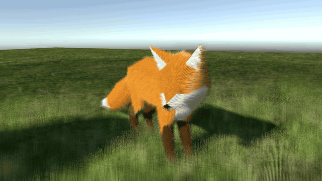

# FurRendering
Fur and grass rendering in Unity 6 (URP) with shell texturing.

All shells of a mesh are drawn in one instanced draw call, read straight from the mesh's GPU buffers, or from the GPU-skinned vertices of an animated character. Strands are generated procedurally, antialiased with alpha to coverage, lit with Kajiya-Kay hair shading, and bend with gravity, wind and the motion of the skin.

To use it, give a renderer a material with the `FurRendering/Shell Fur` shader and add the `ShellFur` component.

## Credits
Fox model by PixelMannen (CC0), rigging and animation by tomkranis (CC-BY 4.0), glTF conversion by AsoboStudio and scurest (CC-BY 4.0), from the [Khronos glTF sample models](https://github.com/KhronosGroup/glTF-Sample-Models/tree/main/2.0/Fox).
